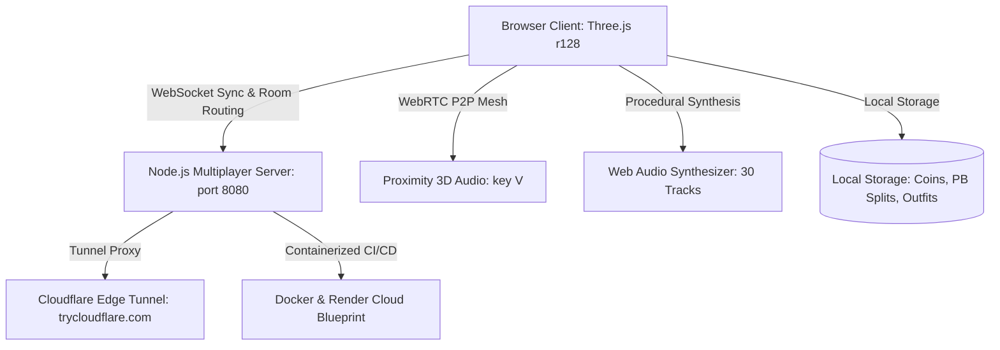

# 🎮 Roblox 3D Obby Simulation - Pro Multiplayer & Gaming Edition

[](https://github.com/soumyadeepmagnusx/roblox-obby-sim/actions/workflows/ci.yml)
[](https://opensource.org/licenses/MIT)
[](https://nodejs.org/)
[](https://threejs.org/)

A high-performance 3D gaming platform built in the true spirit of **Roblox**, featuring **Real-Time Multiplayer with Rooms**, **WebRTC Proximity Voice Chat**, **3D Cartoon Speech Bubbles**, **Speedrun Split Timer & Personal Bests**, **Vehicles (Cyber Hoverboard & Jetpack)**, **Pets & Mystery Egg Hatching**, **PvP Combat & Rocket Launchers**, **Bengali & English Hit Music**, an **Anti-Glitch & Security Engine**, and an in-game **Roblox Studio Sandbox Builder**.

---

## 🌟 Architecture Diagram



---

## 🌐 Instant Play & Online Access

* **Local Play (Active Server)**: **[http://localhost:8080](http://localhost:8080)**
* **Local Network (Friends on Same Wi-Fi)**: **`http://192.168.1.7:8080`** *(Works seamlessly on phones, tablets & laptops)*
* **1-Click Worldwide Cloudflare Tunnel**: Double-click **`start_online_tunnel.bat`** for a high-speed public HTTPS link with **zero passwords** and **zero 503 errors**!
* **1-Click Render.com Cloud**: Connect this repo to [Render.com](https://render.com) for 24/7 hosting.
* **GitHub Repository**: **[https://github.com/soumyadeepmagnusx/roblox-obby-sim](https://github.com/soumyadeepmagnusx/roblox-obby-sim)**

---

## 🎮 Complete Keyboard Controls Reference

| Action | Key / Control | Description |
| :--- | :--- | :--- |
| **Movement** | `W` `A` `S` `D` / Arrow Keys | Move avatar in 3D world |
| **Jump** | `Spacebar` | Jump over gaps and obstacles |
| **Camera Orbit** | Right Click + Drag | Rotate 3D camera angle |
| **Zoom** | Mouse Scroll Wheel | Zoom camera in and out |
| **Shift Lock** | `Left Shift` / `Right Shift` | Locks camera behind character with centered crosshair |
| **Reset Character** | `R` | Triggers classic "OOF!" ragdoll and respawns at active checkpoint |
| **Restart Speedrun** | `T` (or click Timer HUD) | Resets timer to 0:00 and teleports back to Stage 1 Spawn |
| **Voice Chat (Mic)** | `V` | Toggles microphone on/off with 3D proximity volume and overhead indicator |
| **Chat & Speech Bubbles**| `/` or `Enter` | Opens chat box; messages float as 3D cartoon speech bubbles above head |
| **Grappling Hook** | `H` (or click 🪝) | Fires a high-tension neon cable to pull avatar across wide gaps |
| **Roblox Emotes Wheel** | `J` (or click 💃) | Opens Emotes Wheel: Breakdance, Floss, Zombie, Backflip, Headspin, Dab, Wave |
| **Cosmetic 3D Auras** | `Z` (or click 🌀) | Cycles 5 3D Auras: Golden Halo, Lightning Orbiters, Void Vortex, Frost, Fire |
| **Shift-Lock Crosshairs** | `C` (or click 🎯) | Cycles 4 custom crosshairs: Classic Cross, Precision Dot, Brackets, Tactical |
| **Speedrun Pacer Ghost** | `X` (or click 👻) | Toggles holographic 3D PB ghost runner with real-time delta badge |
| **Companion Hover Drone** | `O` (or click 🤖) | Toggles 3D companion AI drone scanning for nearby coins and lava hazards |
| **Lucky Spin Wheel** | `G` (or click 🎡) | Opens daily prize wheel awarding bonus studs and potion buffs |
| **Hoverboard** | Mount via Vehicles | Mounts glowing cyber hoverboard with +120% speed and banking physics |
| **Jetpack Thrust** | Hold `J` / Hold `Space` | Activates dual rocket thrusters with smoke and flame exhaust particles |
| **Interact / Grab** | `E` | Hatches mystery eggs at spawn or grabs physics crates to throw |
| **Hotbar Slots** | `1` to `6` | Equips Speed Coil, Gravity Coil, Sword, Grapple Hook, Grab Gun, Rocket Launcher |
| **Attack / Fire** | Left Click | Swings sword for PvP melee or fires explosive rocket projectile |
| **Studio Builder** | `B` | Toggles sandbox building mode to place custom colored blocks |
| **Atmosphere Theme** | `L` (or click HUD) | Cycles Day, Sunset, Night Starfield, and Synthwave Neon |
| **Cinematic Photo Mode** | `P` (or click 📸) | Hides UI, enables Freecam drone, color filters, and PNG photo capture |
| **2D Radar Mini-Map** | `M` (or click 🗺️) | Toggles real-time 2D tactical radar with stage markers, coins, and peers |
| **Dynamic Weather Cycle** | `K` (or click 🌦️) | Cycles weather simulation: Clear Sky, Downpour Rain, Snow, Meteor Shower |
| **Atmosphere & Lighting** | `L` (or click ☀️) | Cycles 5 celestial lighting presets: Noon, Sunset, Midnight, Synthwave, Dawn |
| **Alchemist Potion Shop** | `Y` (or click 🧪) | Opens power-up shop: Moon Gravity, Hyper Speed, Coin Magnet, Lava Shield |
| **Avatar Wardrobe** | `U` (or click 🎩) | Equips 3D cosmetic accessories: Fedora, Crown, Angel Wings, Katanas, DJ Cans |
| **3D Headwear & Pets** | `N` (or click 🧢) | Cycles 5 wearable accessories: Stetson, Wizard Hat, Snapback, Cyber Visor, Kitty |
| **Spectator Camera** | `F` (or click 👁️) | Toggles 3D Obby Spectator Camera mode to orbit peers or view scenic stage spots |
| **Double Jump** | Double `Space` | Mid-air second jump boost with crystal burst particles and ascending chime |
| **Avatar Skin Tint** | Click 🎨 Skin | Customizes Head, Torso, Arms, and Legs with classic Roblox color themes |
| **System Telemetry** | `F3` (or click 📊) | Toggles live FPS, frame render latency ms, renderer draw calls, and network ping |
| **Squad & Clan Tags** | Click 🛡️ Clan | Equips clan tag prefix (e.g. `[PRO]`, `[TITN]`, `[VOID]`) in overhead nametag & chat |
| **Audio Mixer** | Click 🎚️ Audio | Multi-channel volume mixer for Master, Music, SFX, and Ambience channels |
| **Player Trading** | Click 🤝 Trade | Secure peer-to-peer and merchant NPC trading for coins, pets, and potions |
| **Custom Keybinds** | Click ⌨️ Keys | Complete hotkey remapping manager with conflict detection and reset defaults |
| **Career Passport** | Click 👤 Profile | View player level, stats, achievements, and 5-axis career attribute radar |
| **Prestige Titles & Ranks**| Click Titles 🎖️ | Displays floating rank nameplates (Noob, Jumper, Champion, Legend) |
| **Obby Quest Board** | `Q` (or click 📜) | Tracks live milestone quests on HUD and grants coin bounties |
| **Hall of Fame & Records**| Click 🏆 Records | Displays career distance, session playtime, PB speedruns & lobby standings |
| **Avatar Particle Trails** | Click Trails HUD | Opens Trail Shop to equip ribbon auras (Rainbow, Blaze, Cyber, Stardust, Gold) |
| **Stage Navigator / Warp** | Click Stages HUD | Instantly teleports between any unlocked Obby checkpoints + Sky Islands |
| **Achievements & Badges** | Topbar 🎖️ Pill | View 10 unlockable milestone badges with coin bounties |
| **Boombox Music** | Click Boombox / UI | Plays 18 procedural Bengali & global hits with volume slider & live visualizer |
| **Daily Streak Rewards** | Click Topbar 🔥 Pill | Opens 7-day login streak rewards modal with coin bonuses |
| **Mobile Touch Controls** | Dynamic Joystick | On-screen floating analog stick + Jump/Action touch buttons for phones |
| **Gamepad Controller** | Xbox / PS / Generic | Analog stick movement, right-stick camera orbit, A jump, triggers action |

---

## 🎙️ WebRTC Proximity Voice Chat & 3D Speech Bubbles (`voice.js` & `speech_bubbles.js`)

* **3D Proximity Audio**: Real-time Peer-to-Peer WebRTC voice chat. Audio scales with distance—friends sound louder as you walk closer to them.
* **Overhead Speaking Indicator**: A green glowing microphone speaker sprite appears above your avatar's head while transmitting.
* **Cartoon 3D Speech Bubbles**: When anyone types in chat, a clean white billboard speech bubble with rounded corners and a cartoon tail floats above their character in 3D for 5 seconds.

---

## ⏱️ Speedrun Timer, Splits & Personal Bests (`game.js`)

* **Millisecond Precision**: Real-time HUD displaying `MM:SS.mmm`.
* **Personal Best (PB) Tracking**: Automatically saves your fastest time to `localStorage`.
* **Split Delta Indicators**: Shows green `(-X.Xs)` when ahead of your best run or red `(+X.Xs)` when behind at every stage checkpoint.
* **1-Key Restart**: Press **`T`** anytime to restart your speedrun attempt from Spawn.
* **Victory Celebration**: Reaching the final trophy stage triggers gold confetti particle explosions and victory sound!

---

## 👥 Multiplayer Rooms & Cloudflare Tunneling (`server.js` & `network.js`)

* **Private Room URL**: Add `?room=squad` to your link (e.g. `https://....trycloudflare.com/?room=mysquad`) to create an isolated world just for your friends.
* **Zero-Password Tunnel**: Powered by Cloudflare's high-speed edge tunnel (`start_online_tunnel.bat`), eliminating the unstable 503 errors and password splash screens of legacy tunnels.
* **Full HTTPS / WSS Support**: Enables secure microphone permissions across all web browsers.

---

## 🛹 Vehicles, Pets & Economy (`vehicles.js`, `pets.js`, `collectibles.js`)

* **Cyber Hoverboard (Press `H`)**: 2.2x speed multiplier with banking body tilt.
* **Dual Thruster Jetpack (Press `J`)**: Dynamic flight with fuel HUD bar that automatically recharges on the ground.
* **Mystery Egg Hatching**: Walk up to the golden pedestal at Spawn and press **`E`** to hatch one of 4 animated 3D pets:
  * 🐶 **Neon Doge** (+25% Coins)
  * 🐱 **Pixel Kitty** (+35% Coins, +10% Speed)
  * 🐉 **Cosmic Dragon** (+50% Coins, +25% Super Jump, flapping wings)
  * 👑 **Golden Dominus** (2x Coins, +30% Speed & Jump)
* **40+ 3D Gold Coins**: Distributed across stages, sky islands, and mega slides.

---

## 📻 Procedural Bengali & English Music Playlist (`music_player.js`)

Synthesized entirely via the Web Audio API—zero external audio file downloads required:
1. 🇧🇩 **Purano Shei Diner Kotha** (Rabindranath Tagore Classic)
2. 🇧🇩 **Ami Shudhu Cheyechi Tomay** (Romantic Bengali Theme)
3. 🇧🇩 **Bojhena Shey Bojhena** (Iconic Bengali Melody)
4. 🇧🇩 **Barandaye Roddur** (Bhoomi Folk Rock)
5. 🌍 **Faded** (Alan Walker Global Anthem)
6. 🌍 **The Spectre** (Alan Walker EDM)
7. 🌍 **Astronomia** (Coffin Dance Anthem)
8. 🎮 **Megalovania** (Undertale Arcade Battle)
9. 🎮 **Bad Apple!!** (Touhou Arcade Hit)
10. 🇧🇩 **Tomake Chai** (Kabir Suman Iconic Anthem)
11. 🇧🇩 **Aalo** (Tahsan Romantic Melody)
12. 🎮 **Tetris Korobeiniki** (Nintendo Game Boy 8-Bit)
13. 🇧🇩 **Alo Chaya** (Tahsan & Nancy Duet Classic)
14. 🌍 **Never Gonna Give You Up** (Rick Astley Meme Anthem)
15. 🇧🇩 **Ekla Cholo Re** (Rabindranath Tagore Immortal Anthem)
16. 🎮 **Can You Feel My Heart** (Bring Me The Horizon / GigaChad Theme)
17. 🇧🇩 **Gram Chara Oi Ranga Matir Poth** (Rabindranath Tagore Baul Classic)
18. 🦀 **Crab Rave** (Noisestorm - Iconic Celebration Dance)
19. 🇧🇩 **Chokher Aloy** (Rabindranath Tagore Classic)
20. ⚡ **Sandstorm** (Darude High-Energy Arcade Synth)
21. 🇧🇩 **Bhalobashibo Bashibo Re** (Habib Wahid Bengali Folk Pop)
22. 🕹️ **Super Mario Bros. Theme** (Koji Kondo Retro Gaming Classic)
23. 🇧🇩 **Ami Banglay Gaan Gai** (Pratul Mukhopadhyay Bengali Anthem)
24. 🎮 **Wet Hands** (C418 Minecraft Piano Theme)
25. 🇧🇩 **Dhitang Dhitang Bole** (Salil Chowdhury Bengali Folk Classic)
26. 🇧🇩 **Dhono Dhanyo Pushpo Bhora** (D. L. Roy Patriotic Anthem)
27. 🎮 **Pokemon Theme** (Gotta Catch 'Em All Classic Gaming)
28. 🇧🇩 **Mayabonobiharini Horini** (Rabindranath Tagore Melody)
29. 🕹️ **Mortal Kombat Techno Anthem** (The Immortals Arcade Hit)
30. 🇧🇩 **Aguner Poroshmoni** (Rabindranath Tagore Sacred Classic)
31. 🇧🇩 **Coffee Houser Shei Adyata** (Manna Dey Bengali Nostalgia Classic)
32. 🎮 **Mega Man 2 - Dr. Wily Stage 1** (Capcom NES Chiptune Anthem)
33. 🇧🇩 **Majhe Majhe Tobo Dekha Pai** (Rabindranath Tagore Devotional Masterpiece)
34. 🕹️ **Mii Channel Theme** (Kazumi Totaka Nintendo Wii Classic)
35. 🇧🇩 **Bhenge Mor Ghorer Chabi** (Rabindranath Tagore Classic)
36. 🇧🇩 **Ami Chini Go Chini Tomare** (Rabindranath Tagore Timeless Lyric)
37. 🕹️ **The Legend of Zelda - Overworld Theme** (Koji Kondo Classic Chiptune)
38. 🇧🇩 **O Je Mane Na Mana** (Rabindranath Tagore Expressive Raga)
39. 🎮 **Doom E1M1 - At Doom's Gate** (Bobby Prince Adrenaline Metal Chiptune)
40. 🇧🇩 **Shei Tumi Keno Eto Ochena Hole** (Ayub Bachu Iconic Rock Ballad)
41. 🇧🇩 **Mone Rekho** (Rabindranath Tagore Eternal Melodic Classic)
42. 🎮 **Castlevania - Vampire Killer** (Kinuyo Yamashita NES Konami Arcade)
43. 🇧🇩 **Ami Chini Go Chini Tomare (Folk)** (Rabindranath Tagore Classic)
44. 🕹️ **The Legend of Zelda Overworld** (Koji Kondo Nintendo NES Masterpiece)
45. 🇧🇩 **Amaro Porano Jaha Chay** (Rabindranath Tagore Eternal Devotional Classic)

*Features 45 synthesized tracks, an interactive **Master Volume Slider**, **Multi-Channel Mixer**, **Shuffle** & **Loop** playback modes, and real-time neon equalizer bars.*

---

## ✨ Cosmetic Customization, Quests, Records & Power-Ups

### 📜 Interactive Obby Quest Board (`quests.js`)
* **HUD Mission Tracker**: Compact floating mission tracker shows active progress bars and instant claim notifications.
* **5 Rewarding Quests**: Stud Hunter, Lava Leap Survivor, Cloud & Sky Explorer, Alchemist Initiate, and Robloxian Stylist—earning up to 85 bonus golden studs!

### 🏆 Hall of Fame & Career Stats (`leaderboard.js`)
* **Lifetime Telemetry**: Tracks cumulative distance traveled (studs), total playtime, highest unlocked stage, total OOF deaths, and Personal Best speedrun times.
* **Live Lobby Standings**: Automatically ranks all active players in your multiplayer room by current stage progress and collected studs.

### 🎖️ Prestige Titles & Ranks (`titles.js`)
* **Overhead 3D Nameplates**: Unlocks and displays luminous title tags above your character (e.g. `[👑 Obby Champion]`, `[⭐ Roblox Legend]`).
* **Achievement Based**: Titles unlock as you conquer stages, amass coins, beat speedruns, or maintain daily streaks.

### 🌌 Starlight Sky Islands Secret Bonus Realm (`bonus_stage.js`)
* **Secret Launchpad**: Hidden super trampolines catapult players 70+ studs into the sky to a floating galaxy island.
* **Low Gravity Mechanics**: Floaty jump physics, rotating nebula halo rings, and 5 rare collectible amethyst crystals (+5 studs each).
* **Return Warp Portal**: Safely teleports players back to the main obstacle course.

### 🧪 Alchemist Potion Shop (`potions.js`)
* **Power-Up Consumables**: Purchase tactical potions using in-game studs:
  * 🌙 **Moon Gravity Elixir**: Reduces gravity by 55% for effortless gap clearing.
  * ⚡ **Hyper Sonic Potion**: Boosts sprinting speed by +80%.
  * 🧲 **Stud Attractor Magnet**: Pulls all nearby coins directly to your character.
  * 🛡️ **Obsidian Lava Shield**: Grants complete temporary immunity to lava hazards.
* **Buff Status HUD**: Real-time timer bars display remaining active potion duration.

### 🎩 Avatar Accessory Wardrobe (`accessories.js`)
* **Procedural 3D Wearables**: Wear classic Roblox accessories:
  * 🎩 **Classic Noir Fedora**: Wide-brim fedora with white silk ribbon.
  * 👑 **Golden King Crown**: Encrusted with ruby gemstones.
  * 🪽 **Celestial Angel Wings**: Animated feathered wings that flap as you jump.
  * ⚔️ **Dual Ninja Katanas**: Crossed samurai blades mounted on back.
  * 🎧 **Cyberpunk DJ Headphones**: Neon cyan earcups with bass glow.

### ☀️ Celestial Atmosphere & Lighting Engine (`lighting.js`)
* **Multi-Preset Lighting**: Cycle between 5 dynamic environmental ambiances with Key **`L`**:
  * ☀️ **Vibrant Noon**: Bright sky blue with radiant sunlight.
  * 🌅 **Golden Sunset**: Warm amber horizon and soft purple gradients.
  * 🌌 **Midnight Starfield**: Deep navy night with luminous lunar glow.
  * 👾 **Synthwave Neon**: Retro vaporwave violet with hot pink rim lights.
  * 🌸 **Cherry Blossom Dawn**: Soft pastel morning mist.

---

## ✨ Cosmetic Trails, Weather & Navigation HUDs

### 🌈 Avatar Particle Ribbon Trails (`trails.js`)
* **Dynamic Ribbon Geometry**: Tapered 3D ribbon strips with additive blending and opacity fading.
* **5 Cosmetic Presets**: Rainbow Ribbon, Blaze Inferno, Neon Cyber, Cosmic Stardust, and Midas Gold.
* **Local Persistence**: Equipping a trail auto-saves to `localStorage` and persists across sessions.

### 🌦️ Atmospheric Weather System (`weather.js`)
* **650+ Real-Time Particle Simulation**: Dynamic falling rain drops, fluttering winter snow flakes, and cosmic shooting star meteor trails anchored smoothly around the active player.
* **Quick Cycle**: Press **`K`** or click the Weather HUD button to switch between Clear, Rain, Snow, and Meteor Shower presets with atmospheric lighting transitions.

### 🚀 Checkpoint Stage Navigator (`teleport.js`)
* **Instant Stage Warp**: Travel instantly between Spawn Island and Stages 1–6 with particle sparkles and audio chimes.
* **Anti-Cheat Lock**: Players can only teleport to stages they have previously unlocked by reaching their checkpoint.

### 🗺️ 2D Tactical Radar Mini-Map (`minimap.js`)
* **Live Radar Overlay**: Real-time 140x140px canvas mini-map with rotating player direction arrow, checkpoint markers, hazard killbricks, gold coins, and multiplayer peer tracking.
* **Interactive Zoom**: Click the radar to cycle between 0.6x (wide), 1.0x (standard), and 1.6x (close-up) zoom scales, or press **`M`** to toggle visibility.

### 🎡 Lucky Spin Wheel, VFX & Companion Systems (`spin_wheel.js`, `particles.js`, `drone.js`)
* **Lucky Spin Wheel (`spin_wheel.js`, Key `G`)**: Daily/timed prize wheel awarding bonus studs, temporary speed/jump buffs, and confetti celebrations.
* **Impact & Sprint Particles (`particles.js` + `player.js`)**: Dynamic radial landing shockwave rings, jump bursts, and sprint dust clouds.
* **3D Companion Hover Drone (`drone.js`, Key `O`)**: Autonomous hovering AI drone that orbits smoothly and scans nearby coins and lava hazards.

### 🎯 Dynamic Camera & Speedrun Pacer Ghost (`camera.js`, `ghost.js`)
* **Dynamic Speed FOV & Crosshairs (`camera.js`, Key `C`)**: Smooth velocity-reactive FOV warp (65°–81°) when sprinting, boosting, or riding hoverboards, plus 4 Shift-Lock crosshair styles (`classic`, `dot`, `brackets`, `tactical`).
* **3D Speedrun Pacer Ghost (`ghost.js`, Key `X`)**: Records your Personal Best run to `localStorage` and projects a translucent cyan holographic R6 pacer ghost alongside you on subsequent runs.
* **Real-Time Ghost Delta Tracker**: Live HUD split badge displays whether you are ahead (`⚡ -0.42s` in green) or behind (`👻 +0.65s` in red) your personal best ghost in real time.

### 🪝 Grappling Hook & Zip-Line Gear (`grapple.js`, Key `H`)
* **Neon Tension Cable**: Fires high-velocity grappling cable targeting distant ledges, platforms, or elevated checkpoints up to 65 studs away.
* **Vault Momentum**: Automatically releases when within range and grants an upward vault boost for seamless platforming.

### 💃 Viral Roblox Emote Engine & Dance Wheel (`emotes.js`, Key `J`)
* **9 Iconic Dances & Gestures**: Breakdance, The Floss, Zombie Walk, Acrobatic Backflip, Breakdance Headspin, Classic Dab, Friendly Wave, Victory Cheer, and Point Forward.
* **Chat Command Support**: Type `/e dance`, `/e floss`, `/e zombie`, `/e flip`, `/e spin`, or `/e dab` directly in game chat.

### 🏛️ Checkpoint Ascending Light Pillars & Stage Billboards (`checkpoint_fx.js`)
* **Ascending Neon Beacons**: Translucent vertical light pillars and rotating halo rings at every checkpoint pad that pulse brightly upon activation.
* **Floating 3D Billboards**: Crisp overhead badges showing stage titles and icons (`SPAWN ISLAND` through `STAGE 6: SUMMIT OF VICTORY`) with sinusoidal floating animations.

### 💥 Immersive Screen VFX Overlay Engine (`vfx_overlay.js`)
* **Low-Health Heartbeat Vignette**: Chromatic red pulsing screen edges when avatar health drops below 35 HP.
* **Hazard & Reward Bursts**: Instant red impact flash on lava damage and warm golden radial vignette upon collecting studs and secret crystals.
* **High-Speed Motion Streaks**: Radial wind and speed lines during sprinting, potion speed buffs, and grappling hook traversal.

### 🏃 Parkour Jump Combo & Momentum Multipliers (`jump_combos.js`)
* **Consecutive Jump Chains**: Chaining clean parkour jumps within 2.4 seconds builds a dynamic combo counter up to 10x+.
* **Stud Bounties**: Reaching 3x, 6x, and 10x milestones triggers particle celebrations and awards bonus golden studs.

### 🚀 Spring Physics Trampolines & Directional Launchers (`launchers.js`)
* **Super Trampolines**: Spring-loaded bounce pads with mechanical compression and rebound animations that launch avatars 30 studs into the air.
* **Booster Launch Cannons**: Angled launch pads providing directional velocity impulses across long chasms with exhaust smoke trails.

### 🌀 Holographic Cosmetic Auras & Halo Rings (`auras.js`, Key `Z`)
* **5 Equippable 3D Auras**: Golden Angelic Halo, Hyper Lightning Orbiters, Cosmic Void Vortex, Glacial Frost Shards, and Inferno Flame Rings.
* **Orbital Physics**: Auras dynamically orbit, bob, and spin around the avatar with persistent local storage.

### 🌌 Stage 7: Cyber Neon Nebula & Master's Apex (`world.js`)
* **High-Altitude Extension**: 8 floating neon hexagonal steps ascending past Winner's Peak with spinning hazard bars.
* **Master's Diamond Crystal**: Glowing floating apex sanctuary guarded by obsidian monoliths with bonus coin clusters.

### 🌋 Stage 8: Inferno Volcanic Core & Molten Geysers (`world.js`)
* **Molten Hazard Traversal**: Sinking basalt stepping pillars over boiling magma with high-velocity spinning hazard bars.
* **Volcanic Caldera Apex**: Floating dodecahedron molten core surrounded by glowing magma spires and bonus studs.

### 👑 Stage 9: Summit of the Titans & Celestial Crown Shrine (`world.js`)
* **High-Altitude Crystal Bridges**: Translucent purple and cyan crystal stepping blocks ascending into the upper atmosphere.
* **The Grand Champion Throne**: Golden royal throne with ruby backrest and rotating animated Celestial Crown with gems.

### 🌌 Stage 10: The Void Dimension & Anti-Matter Rift Vortex (`world.js`, `checkpoint_fx.js`)
* **Anti-Matter Void Traversal**: Deep purple anti-matter stepping platforms floating over an event horizon chasm.
* **Spinning Hazard Lasers & Rift Vortex**: Rotating quad-arm laser hurdles and swirling particle singularity with checkpoint beacon fx.

### ✨ Stage 11: Celestial Aurora Highway & Prismatic Apex (`world.js`, `checkpoint_fx.js`)
* **Iridescent Prism Ramps**: Translucent aurora highway with rainbow-tinted crystal paths leading to the sky summit.
* **Celestial Halo Beacon**: Floating star crown monolith emitting ascending aurora particle beams and golden victory studs.

### 🐉 Stage 12: Dragon Fire Spire & Molten Helix (`world.js`, `checkpoint_fx.js`)
* **Ascending Molten Helical Pillars**: Obsidian stepping stones twisting around a massive dragon core pillar with spinning flame hurdles.
* **Dragon Horn Apex Sanctuary**: Floating dragon core sphere emitting volcanic embers with four radiant dragon horn spires.

### ⚡ Stage 13: Quantum Cyber Matrix & Singularity Core (`world.js`, `checkpoint_fx.js`)
* **Phasing Cyber Voxel Matrix**: Alternating neon cyan and magenta stepping blocks suspended over a quantum abyss.
* **Quantum Singularity Core**: Giant rotating wireframe torus portal leading to a floating octahedron singularity with cyber monoliths.

### 🤝 Player & Merchant Trading System (`trading.js`)
* **Interactive Trade Window**: Trade studs, pets (Doge, Kitty, Dragon, Dominus), and potions (Moon Gravity, Speed, Magnet, Shield).
* **Two-Way Lock & Accept**: Secure lock-in mechanism with instant fair counter-offers from the Obby Merchant NPC.

### ⌨️ In-Game Keybinds Customizer (`keybinds.js`)
* **Custom Control Remapping**: Remap Jump, Sprint, Grapple, Emotes, Camera, Radar, and menu shortcuts with conflict checking.
* **Local Persistence**: Keybindings auto-save to `localStorage` with one-click "Reset Defaults" fallback.

### 🎧 Sound Effect Audio Profiles (`audio.js`, `sound_mixer.js`)
* **Selectable SFX Packs**: Choose between Classic Roblox, 8-Bit Retro NES (square-wave chiptune blips), and Arcade Synth.
* **Quick Selector**: Instant audio pack switching directly within the Multi-Channel Audio Mixer.

### 🎄 Holiday Starlight Festival Lighting & Weather (`lighting.js`, `weather.js`)
* **Festival Atmosphere**: Midnight navy lighting with warm holiday golden rim lights and twinkling celestial stars.
* **Starlight Precipitation**: 450+ multi-colored festive starlight particles floating gracefully around the avatar.

### 👤 Player Career Passport & Profile Card (`profile_card.js`)
* **Interactive Player Passport**: View level, XP progress, clan tag, equipped prestige title, studs, PB speedrun, and relics.
* **5-Axis Attribute Radar**: Dynamic canvas radar pentagram graphing Speed, Parkour, Exploration, Wealth, and Prestige.

### 🆙 Player Level & XP Progression System (`level_system.js`)
* **Dynamic XP Tracking**: Earn experience points by clearing checkpoints, collecting studs, finding relics, and completing daily quests.
* **Level-Up Celebrations**: Floating gold XP banner, ascending sound fanfare, and persistent level badges on the HUD.

### 🦘 Double Jump & Aerial Mobility (`player.js`, `audio.js`)
* **Acrobatic Air Jump**: Press `Space` mid-air to trigger an additional vertical impulse with cyan ring shockwaves and acoustic chimes.
* **Refined Parkour**: Enables fluid gap recoveries and challenging aerial shortcuts across advanced stages.

### 🎨 Customizable Avatar Skin Tone & Color Palette (`skin_customizer.js`)
* **Classic Robloxian Customization**: Independent color selectors for Head, Torso, Left/Right Arms, and Left/Right Legs.
* **Pre-Engineered Themes**: Quick-pick palettes (Classic Noob, Neon Cyber, Golden God, Midnight Shadow, Pastel Dream).

### 💨 High-Altitude Wind Gusts & Turbulence Simulation (`wind_system.js`)
* **Atmospheric Force Simulation**: Directional wind gusts at upper obby altitudes that gently push players in mid-air.
* **Breeze VFX & Audio**: Procedural wind streak particles and dynamic whistling wind sound effects that scale with elevation.

### 💎 Ancient Relic Gems & Secret Hunter Tracker (`collectibles.js`)
* **Hidden Amethyst Relics**: 5 rare high-value relics tucked away in covert alcoves and secret sky perches.
* **HUD Relic Counter**: Tracks discovered relics with unique chime fanfare and massive +15 stud bounties per crystal.

### 📊 Real-Time Performance Telemetry Monitor (`telemetry.js`, Key `F3`)
* **Live System Metrics**: Diagnostic overlay displaying real-time FPS, frame render latency (ms), draw call counts, and network latency ping.
* **Sparkline Graphs**: 60-frame rolling performance visualizer to diagnose frame pacing and client smoothness.

### 🛡️ Clan Tags & Overhead Squad Nametags (`clans.js`)
* **Squad Customizer**: Equip clan tag prefixes like `[PRO]`, `[TITN]`, `[VOID]`, `[NOOB]`, `[GOD]`, and `[VIP]`.
* **Overhead Nametags & Chat**: Clan badges dynamically render beside player names in multiplayer 3D nametags and global chat.

### ⏱️ Speedrun Stage Split Breakdown Modal (`game.js`, `ghost.js`)
* **Full Segment Analysis**: Click on Personal Best (PB) in the HUD to view individual completion times and segment deltas for Stages 1 through 13 with Apex Zenith podium finishes.
* **Ghost Export & Import**: Share speedrun PB ghost codes directly to clipboard or import friends' runs to race holographic pacers!

### 🎚️ Multi-Channel Audio Mixer (`sound_mixer.js`)
* **Dedicated Channel Faders**: Real-time volume sliders for Master, Music, Sound Effects (SFX), and Ambience with quick EQ presets (Default, Night, Arcade, Bass Boost).

### 🧢 3D Headwear & Shoulder Companions (`hats.js`, Key `N`)
* **5 Custom Accessories**: Cowboy Stetson, Wizard Hat, Classic Snapback, Cyber Visor, and an animated Shoulder Kitty companion with idle bobbing.

### 👁️ 3D Obby Spectator Camera Mode (`spectator.js`, Key `F`)
* **Cinema Panning**: Cycle between active multiplayer peers and 8 scenic stage viewpoints with smooth camera lerping and overhead HUD navigation banner.

### 👣 Dynamic Surface Footstep Acoustics & Particle Flecks (`audio.js`, `particles.js`)
* **Contextual Material Sound & VFX**: Tailored acoustic pitches and color-matched particle flecks when running across grass, wood, stone, ice, gold, lava, and crystal.

### ⏳ Real-Time Daily Quest & Streak Reset Countdowns (`quests.js`, `streak.js`)
* **Synchronized UTC Timers**: Real-time ticking countdown badges in the HUD, quest board, and streak reward modals.

### 📸 Authentic Photo Mode Canvas Watermark, Depth-of-Field & Framing Guides (`photo_mode.js`)
* **Cinema Capture**: High-res PNG export with authentic Roblox Obby glass watermark badge, aperture vignette shading, rule-of-thirds grid, and fly camera speed toggle.

---

## 🛡️ Anti-Glitch & Security Engine (`security.js`)

* **Continuous Collision Detection (CCD)**: Sub-stepping algorithm prevents high-velocity tunneling through obstacles.
* **Enterprise DDoS Shield**: Per-IP rate limiting (240 requests/minute).
* **AI Chat Moderation**: Instant `####` redaction for toxic language.
* **Admin Controls**: Type `/admin roblox2026` in chat to unlock custom sandbox privileges.

---

## 🐳 Docker & Cloud Deployment

### Docker
```bash
docker build -t roblox-obby-sim .
docker run -p 8080:8080 roblox-obby-sim
```

### Render.com
Push this repository to GitHub and select **New Web Service** on Render. The included `render.yaml` blueprint will configure the service automatically.

---

## 📜 License & Contributions

* **License**: [MIT License](LICENSE) &copy; 2026 Soumyadeep.
* **Contributions**: Pull requests are welcome! Read [CONTRIBUTING.md](CONTRIBUTING.md) for full developer instructions.
